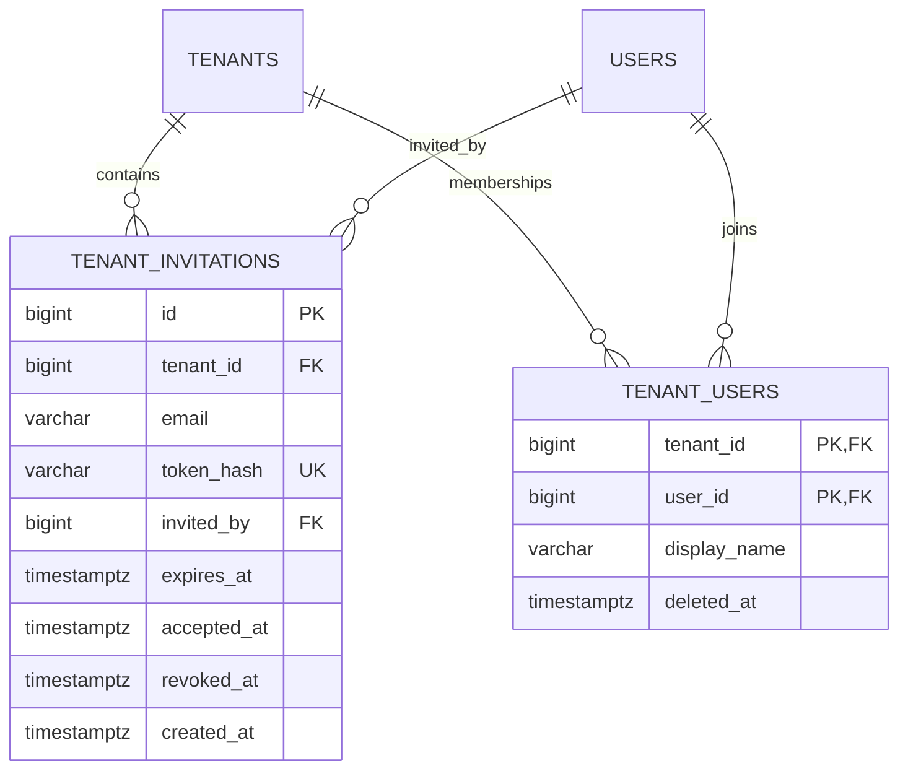

# Invitation schema extension

This diagram extends the original database ER diagram.

## Constraints and behavior

- Each invitation belongs to one tenant.
- invited_by references the global user who created it.
- Recipient email is normalized to lowercase.
- Only the invitation token hash is stored.
- Token hashes are unique.
- A partial unique index allows one pending invitation per tenant/email.
- Reinviting revokes the previous pending invitation.
- Acceptance requires an existing matching global account and its password.
- Acceptance creates or restores a tenant_users membership.
- No roles are granted automatically.
- Membership creation, invitation consumption and audit logging commit together.
- Other tenant memberships remain unchanged.